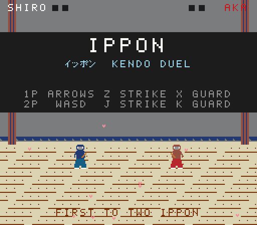
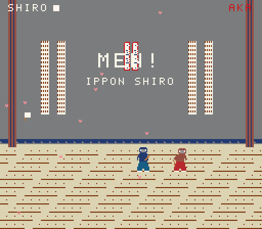
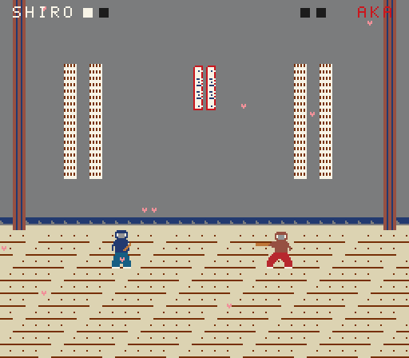
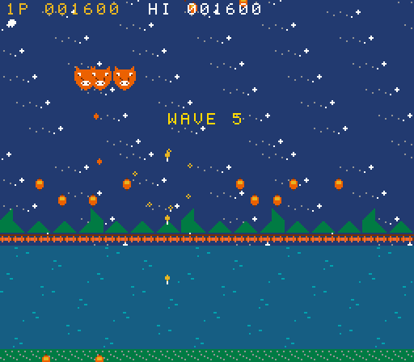
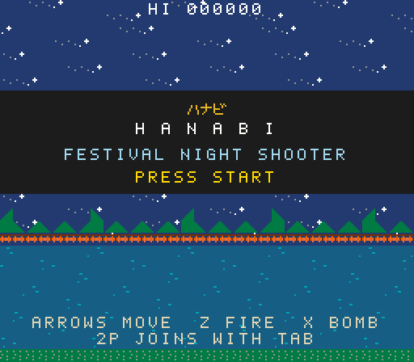

# KAGAMI 鏡

**A deterministic, lockstep-multiplayer fantasy console with a retro Japanese aesthetic.**

[](https://github.com/kaikino/engine/actions/workflows/ci.yml)
[](https://github.com/kaikino/engine/releases)
[](LICENSE)


*Kagami* means mirror. Every player's console runs an identical simulation on
identical inputs, so every screen is a mirror of the others. Nothing but
controller bytes ever crosses the network. A ten-minute match replays from a
few kilobytes, and if two machines ever disagree, the console tells you the
exact frame.

<p align="center">
  
  
  
</p>
<p align="center">
  
  
</p>

## The hardware

KAGAMI is a fantasy console from an alternate 1990. The limits are the point.
They are what makes lockstep determinism practical, and they are permanent.

| | |
|---|---|
| **Display** | 256 × 224 pixels, 60 Hz |
| **Colors** | fixed 32-color palette of traditional Japanese pigments (藍 ai, 朱 shu, 抹茶 matcha, 桜 sakura, …) |
| **Tiles** | 512 tiles of 8 × 8, authored as ASCII art in source |
| **Backgrounds** | 2 scrolling layers of 32 × 32 tiles, per-tile flip and priority |
| **Sprites** | 128 per frame, **16 per scanline** (the rest are dropped, like real hardware), 1 × 1 to 4 × 4 tiles |
| **Overlay** | direct text, lines and rectangles with the built-in 8 × 8 font (ASCII and katakana) |
| **Sound** | 4 channels: two pulse, one triangle, one noise; tracker-style songs |
| **Controller** | d-pad plus A, B, C, START; up to 4 players |
| **Math** | 16.16 fixed point only. **Floats are a compile error** in simulation code. |
| **Netplay** | input-delay lockstep *or* rollback over UDP, hash-checked every N frames |
| **Targets** | native (Linux, macOS, Windows) and the browser via WebAssembly |
| **Replays** | one byte per player per frame, self-verifying |

Everything above lives in the `kagami` crate, which has **zero dependencies**.

## Quick start

```bash
git clone https://github.com/kaikino/engine kagami
cd kagami
cargo run --release -p ippon
```

That opens **IPPON**, a two-player kendo duel. `cargo run --release -p hanabi`
opens **HANABI**, a two-player shooter over a festival river. Player 1 uses the arrow keys
with Z to strike and X to guard. Player 2 uses WASD with J and K. Press Enter
to start. Two ippon win the match. Alone? `--players 1` puts a CPU in the
red hakama.

Things to try next:

```bash
# Play yourself over a simulated lossy network: two lockstep peers in one window.
cargo run --release -p ippon -- --netplay loopback --latency 5 --jitter 3 --loss 100

# Same link with rollback: no stalls, one frame of input delay, corrections instead.
cargo run --release -p ippon -- --netplay loopback --latency 5 --jitter 3 --loss 100 --rollback

# Record a match (F4 also saves one mid-game), then prove it replays bit-for-bit.
cargo run --release -p ippon -- --record match.kgmr
cargo run --release -p ippon -- --verify match.kgmr

# No window at all: simulate 600 frames and write a screenshot.
cargo run --release -p ippon -- --headless --frames 600 --random-inputs --screenshot out.png

# Real netplay on a LAN (run one on each machine).
cargo run --release -p ippon -- --netplay udp --player 0 --bind 0.0.0.0:7777 --peer 192.168.1.5:7777
cargo run --release -p ippon -- --netplay udp --player 1 --bind 0.0.0.0:7777 --peer 192.168.1.4:7777
```

Press F1 in any window for the stats overlay: frame, state hash, stalls,
packets. Full key list and flags: `cargo run -p ippon -- --help`.

### In the browser

The console has no platform code, so it also runs as an 86 KB WebAssembly
module driven by 150 lines of plain JavaScript (no bundler, no bindings
generator):

```bash
rustup target add wasm32-unknown-unknown
scripts/build-web.sh          # -> web/dist/ippon.wasm
python3 -m http.server -d web 8000   # any static server; open http://localhost:8000/
```

CI runs the browser build in headless Chromium and checks that its state
hash after 120 frames equals the native build's. x86-64 and wasm32 agree bit
for bit; that is what fixed-point buys you.

The browser host records every match; *save replay* downloads a `.kgmr`
and dropping one on the page plays it back. CI records a replay in Chromium
and verifies it with the native binary: the same file, two architectures,
every checkpoint equal.

Browser netplay needs no server. Open the *netplay* panel, one player makes
an offer code, the other answers it, and the match runs over a direct WebRTC
data channel with lockstep or rollback, same as native. CI plays a match
between two headless pages and checks they agree.

## Write a cartridge

A cartridge is a type that implements four methods. Here is the whole of
`games/hello`:

```rust
use kagami::{palette, Game, Gpu, StateHasher, UpdateCtx};

struct Hello { x: i32, y: i32, frame: u32 }

impl Game for Hello {
    fn new(_seed: u32) -> Self { Hello { x: 104, y: 108, frame: 0 } }

    fn update(&mut self, ctx: &mut UpdateCtx) {
        let input = ctx.input(0);
        self.x = (self.x + input.axis_x()).clamp(0, 208);
        self.y = (self.y + input.axis_y()).clamp(0, 216);
        if input.a() && self.frame % 10 == 0 {
            ctx.apu.sfx(0, &kagami::Sfx::blip());
        }
        self.frame += 1;
    }

    fn draw(&self, gpu: &mut Gpu) {
        gpu.clear(palette::AI);
        gpu.rect(self.x - 4, self.y - 4, 56, 16, palette::KIN);
        gpu.text(self.x, self.y, "KAGAMI", palette::GOFUN);
    }

    fn hash(&self, h: &mut StateHasher) {
        h.write_i32(self.x);
        h.write_i32(self.y);
        h.write_u32(self.frame);
    }
}

fn main() -> std::process::ExitCode {
    kagami_runtime::main::<Hello>()
}
```

`update` is the simulation, `draw` is presentation, and `hash` is how the
console checks that two machines agree. Put `#![deny(clippy::float_arithmetic)]`
at the top of your crate and the compiler enforces the most important rule.
Everything you need to know is in **[the manual](docs/MANUAL.md)**.

## Repository

| Path | What |
|---|---|
| `crates/kagami` | The console: math, GPU, APU, input, lockstep, replays. No dependencies. |
| `crates/kagami-runtime` | Native runtime: window, keyboard, audio, headless mode, CLI. |
| `games/ippon` | IPPON, the reference cartridge, with the engine's end-to-end tests. |
| `games/hanabi` | HANABI, a two-player festival-night shooter that leans on scrolling, line-scroll reflections and the sprite budget. |
| `games/hello` | The smallest possible cartridge. |
| `crates/kagami-web` | C ABI over the console for the browser; `web/` holds the JavaScript host and its Playwright tests. |
| `web/tools/tiles.html` | Tile editor: paint with the 32 pigments, export Rust art constants, import them back. No build step. |
| `web/tools/tracker.html` | Tracker: four tracks, live preview through the console's own synth in WebAssembly, exports a `Song`. |
| `docs/` | [Manual](docs/MANUAL.md) · [Cookbook](docs/COOKBOOK.md) · [Architecture](docs/ARCHITECTURE.md) · [Determinism](docs/DETERMINISM.md) · [Netcode](docs/NETCODE.md) · [Decisions](docs/DECISIONS.md) · [Roadmap](docs/ROADMAP.md) |
| `scripts/check.sh` | The full quality gate CI runs: fmt, clippy, docs, tests, placeholder scan, release build, headless smoke, replay verify. |

## Performance

`cargo run --release -p kagami-runtime --example bench` on one core of a
2026 cloud VM, 3,000 frames with seeded random inputs:

| Cartridge | `update` only | `update` + audio + full render |
|---|---|---|
| IPPON | 0.1 µs/frame | 0.50 ms/frame (33× realtime) |
| HANABI | 0.1 µs/frame | 0.58 ms/frame (29× realtime) |

Simulation is effectively free, which is why rollback can re-simulate eight
frames without anyone noticing. The compositor is a plain per-scanline loop
over a `Vec<u8>`; at half a millisecond a frame it leaves the other 16 ms
to the operating system.

## Quality bar

- `scripts/check.sh` is green on Linux, macOS and Windows for every commit on `main`.
- A pinned **golden state hash** of a 600-frame IPPON match must come out identical on all three operating systems. That test is the determinism guarantee, enforced by CI.
- Line coverage of the console and runtime is held at or above 85%.
- Clippy runs with the pedantic group and warnings as errors. Every public item is documented, and the docs build with warnings as errors.
- No placeholder macros and no unfinished-work markers anywhere in the tree, checked by script.
- `docs/replays/demo.kgmr` is a recorded match that every build must verify. If the simulation ever changes, that file and the golden hash change together, and the changelog says so.

## Status

v0.2.0. A complete console you can ship a game on today, native or in the
browser, with lockstep or rollback netplay on both. One deliberate limit
remains: games are compiled in (no cartridge loader). The [roadmap](docs/ROADMAP.md) explains what comes next and,
just as importantly, what will never change.

## License

MIT. See [LICENSE](LICENSE).
